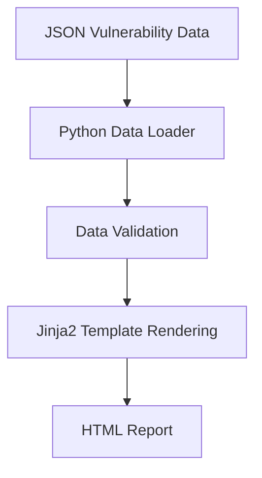

# Pentest Report Generator

A Python-based tool designed to automate the generation of structured penetration testing reports using JSON data, Jinja2 templates, HTML, and CSS.

The project aims to simplify vulnerability documentation and reduce the time spent manually creating security assessment reports.

## Features

- JSON-based vulnerability input.
- Vulnerability data validation.
- CVSS severity classification.
- Vulnerability summary calculation.
- Dynamic HTML report generation.
- Customizable Jinja2 templates.
- Professional CSS styling.
- Vulnerability description, impact, and remediation support.

## Technologies

- Python
- Jinja2
- JSON
- HTML5
- CSS3

## Installation

Clone the repository:

```bash
git clone https://github.com/FrancoMaute/Report-Generator.git
cd Report-Generator
```

Create a virtual environment:

```bash
python -m venv .venv
```

Activate the virtual environment:

```bash
source .venv/bin/activate
```

For Fish shell:

```fish
source .venv/bin/activate.fish
```

Install Jinja2:

```bash
pip install jinja2
```

## Project Structure

```text
Report-Generator/
├── main.py
├── data/
│   └── findings.json
├── templates/
│   ├── report.html
│   └── style.css
├── reports/
└── README.md
```

## Usage

### 1. Configure vulnerability data

Edit `data/findings.json` with the information collected during a penetration test.

Example:

```json
{
    "project_name": "Web Application Pentest",
    "target": "http://localhost",
    "findings": [
        {
            "title": "SQL Injection",
            "cvss": 9.8,
            "description": "SQL injection in the login form.",
            "impact": "Unauthorized database access.",
            "remediation": "Use parameterized queries."
        }
    ]
}
```

### 2. Generate the report

Ensure the output directory exists:

```bash
mkdir -p reports
```

Run the program:

```bash
python main.py
```

### 3. Open the report

The generated report is saved to:

```text
reports/report.html
```

Open it in your preferred web browser.

## CVSS Severity Classification

| CVSS Score | Severity |
| ---------- | -------- |
| 9.0–10.0   | Critical |
| 7.0–8.9    | High     |
| 4.0–6.9    | Medium   |
| 0.1–3.9    | Low      |
| 0.0        | None     |

## Workflow



##

Developed by [Franco Maute](https://github.com/FrancoMaute) as part of a cybersecurity and penetration testing portfolio.
